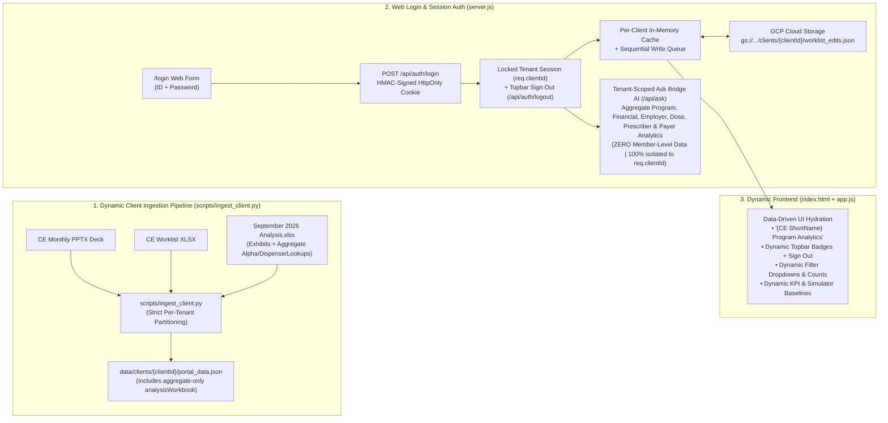

# Multi-Client (Multi-CE) Architecture & Implementation Plan (v7)

> [!IMPORTANT]
> **Confirmed Architectural Decisions (v7):**
> 1. **Zero-Impact Side-by-Side Isolation**: The existing HTTP Basic Auth MVP site (`damien-program-portal`, tag `MVP`, `https://damien-program-portal-525536279111.us-central1.run.app`) remains **100% frozen on HTTP Basic Auth**. The new Multi-Client platform (`bridge-program-portal`) is deployed to a **separate GCP Cloud Run service (`https://bridge-program-portal-525536279111.us-central1.run.app`)** with its own Web Login security system.
> 2. **Web Login & Signed Session Cookie Security System (No Browser Basic Auth Popup)**: Users authenticate via a dedicated **Bridge Health Hub Web Login screen (`/login`)** that sets an HMAC-SHA256 signed `HttpOnly` session cookie (`bridge_session`), strictly locking that session 1-to-1 to the authenticated Covered Entity (`clientId`). A **Sign Out** button (`#btnLogout`) in the top header clears the session and returns to `/login`.
> 3. **Durable Cloud Persistence for Worklist Edits**: Pharmacist updates (`Status`, `Date contacted`, `Notes`, `Corrected patient ID`) are persisted per client in **Google Cloud Storage (GCS)** (`gs://dev-dispatch-331019-portal-state/clients/<clientId>/worklist_edits.json`).
> 4. **Deep Analysis Workbook Integration (`September 2026 Analysis.xlsx`) for Ask Bridge AI (`/api/ask`) — Strictly Aggregate Only (Zero Member-Level Data)**: Free-form AI answers also draw from the underlying `September 2026 Analysis.xlsx` workbook—partitioned strictly per client (`clientId`) at ingestion time and **restricted exclusively to aggregate, de-identified program/channel/employer/prescriber/drug/payer/monthly analytics**. Zero individual member IDs, patient alternate IDs, or row-level member/patient records are ever sent to or returned by Ask Bridge AI.

---

## 0. Side-by-Side Deployment & Zero-Impact Isolation Strategy

| Layer | Existing MVP Site (Frozen / Untouched) | New Multi-Client Site (Isolated) |
| :--- | :--- | :--- |
| **Local Workspace** | `C:\Users\rishi\.gemini\antigravity\scratch\damien-program-portal` | `C:\Users\rishi\.gemini\antigravity\scratch\bridge-program-portal` |
| **GitHub Repo / Branch** | `rishibridge/damien-program-portal` (`main` / tag `MVP`) | `rishibridge/damien-program-portal` (isolated `multi-client` branch, tags `v2.1.0-multi-client` / `v2.2.0-multi-client`) |
| **Cloud Run Service** | `damien-program-portal` `https://damien-program-portal-525536279111.us-central1.run.app` | **`bridge-program-portal`** `https://bridge-program-portal-525536279111.us-central1.run.app` |
| **Security System** | HTTP Basic Auth (`WWW-Authenticate: Basic`) | Dedicated Web Login (`/login`) + HMAC-SHA256 Signed `HttpOnly` Session Cookie (`bridge_session`) + Topbar **Sign Out** |
| **Worklist State Storage** | Local container state inside `damien-program-portal` | Dedicated GCS bucket path `gs://dev-dispatch-331019-portal-state/clients/<clientId>/worklist_edits.json` |
| **Local Test Port** | `3000` / `3099` | `3100` |

---

## 1. Architecture Overview (v7)

---

## 2. Source Document Audit & Extraction Checklist for `September 2026 Analysis.xlsx` (Rule 1 — Aggregate-Only for AI Q&A)

We audited all **10 sheets** in `C:\Users\rishi\OneDrive - Bridge Helath Hub Inc\Bridge Health\Active Projects\Dashboard\September 2026 Analysis.xlsx` (`Damien Exhibits`, `FHS Exhibits`, `Membership Fees`, `Pivot`, `Alpha Data`, `Damien Pivot`, `Damien Dispense Data`, `FHS Dispense Data`, `Lookups`, `Sheet1`). Below is the complete numbered checklist of **aggregate, non-member-level** data elements that will be extracted per client into `portal_data.json -> analysisWorkbook` and exposed to Ask Bridge AI (`/api/ask`):

### Checklist of Aggregate Data Extracted from `September 2026 Analysis.xlsx`

| # | Sheet / Table | Extracted Aggregate Scope & Exact Verified Values (`clientId = "damien"`) | Privacy & Tenant Isolation Rule |
| :- | :--- | :--- | :--- |
| **A1** | **`Damien Exhibits`** Enrollments by Source & Month (Rows 3–12) | Monthly (`Jan`–`Sep` + `YTD`) enrollments by channel: `EPIC` (`452` YTD), `Paid Media` (`417` YTD), `Employee` (`54` YTD), `LHD` (`54` YTD), `Other` (`51` raw / `48` 2026 YTD), `McGohan Brabender` (`8` YTD), `Grand Total = 1,036` (`1,033` in 2026), plus monthly **Broker Share `%`** (`Jun 51.8%`, `Jul 58.0%`, `Aug 64.1%`, `Sep 62.3%`, `YTD 44.4%`). | Aggregate only; loaded **only** into `damien` (`FHS Exhibits` loaded only into `fhs`). |
| **A2** | **`Damien Exhibits`** Membership Cancellations by Source & Month (Rows 14–23) | Monthly (`Jan`–`Sep` + `YTD = 264`) cancellations by source: `Paid Media` (`151`), `EPIC` (`68`), `Employee` (`23`), `Other` (`18`), `LHD` (`3`), `McGohan Brabender` (`1`), plus monthly **`% of Total Enrolled`** (`Jan 16.0%`, `Feb 30.8%`, `Mar 28.9%`, `Apr 14.3%`, `May 17.5%`, `Jun 25.3%`, `Jul 20.6%`, `Aug 27.1%`, `Sep 33.3%`, `YTD 25.5%`). | Aggregate only; loaded **only** into `damien`. |
| **A3** | **`Damien Exhibits`** Active Patient Tracker & Net Additions (Rows 26–29) | Month-end active member count (`Jan: 25`, `Feb: 37`, `Mar: 69`, `Apr: 114`, `May: 179`, `Jun: 223`, `Jul: 448`, `Aug: 655`, `Sep: 862`) and monthly net `Additions` (`Feb: +12`, `Mar: +32`, `Apr: +45`, `May: +65`, `Jun: +44`, `Jul: +225`, `Aug: +207`, `Sep: +207`). | Aggregate only; loaded **only** into `damien`. |
| **A4** | **`Damien Exhibits`** Notable Enrollments by Employer Group by Month (Rows 32–47) | Full monthly (`Jan`–`Sep` + `YTD`) sign-up matrix for the 14 notable employer groups: `City of Evansville` (`52` Aug, `28` Sep, `80` YTD), `Putnam County` (`6` Jun, `8` Jul, `9` Aug, `8` Sep, `31` YTD), `Hamilton Center` (`13` Aug, `16` Sep, `29` YTD), `GCS` (`27` Sep, `27` YTD), `Benton County` (`6` Jun, `11` Jul, `6` Aug, `3` Sep, `26` YTD), `Healthcare Therapy Services` (`6` Jun, `10` Jul, `4` Aug, `20` YTD), `Warrick County` (`13` Aug, `4` Sep, `17` YTD), `City of Lawrence` (`10` Aug, `6` Sep, `16` YTD), `Epic Employees` (`1` Jun, `6` Jul, `5` Aug, `4` Sep, `16` YTD), `IMCU` (`4` Aug, `11` Sep, `15` YTD), `PCSC` (`13` Sep, `13` YTD), `The City of Terre Haute` (`9` Aug, `3` Sep, `12` YTD), `DRG` (`3` Jul, `5` Aug, `4` Sep, `12` YTD), `Bose Mckinney & Evans` (`6` Aug, `4` Sep, `10` YTD). | Aggregate only; loaded **only** into `damien`. |
| **A5** | **`Damien Exhibits`** Dispenses by Drug & Specific Dose Strength by Month (Rows 50–65) | Monthly (`Jan`–`Sept` + `YTD = 2,034`) dispense breakdown across all **13 specific GLP-1 dose strengths**: • `Ozempic 0.25-0.5 Mg/dose (2 Mg/3 Ml) Pen`: `15` YTD (`2` Sep) • `Ozempic 1 Mg/dose (4 Mg/3 Ml) Pen`: `12` YTD (`3` Sep) • `Ozempic 2 Mg/dose (8 Mg/3 Ml) Pen`: `3` YTD (`1` Sep) • `Wegovy 0.25 Mg/0.5 Ml Pen`: `400` YTD (`98` Sep) • `Wegovy 0.5 Mg/0.5 Ml Pen`: `332` YTD (`103` Sep) • `Wegovy 1 Mg/0.5 Ml Pen`: `246` YTD (`69` Sep) • `Wegovy 1.7 Mg/0.75 Ml Pen`: `202` YTD (`49` Sep) • `Wegovy 2.4 Mg/0.75 Ml Pen`: `260` YTD (`72` Sep) • `Wegovy Hd 7.2 Mg/0.75 Ml Pen`: `22` YTD (`20` Sep) • `Wegovy 1.5 Mg Tablet`: `263` YTD (`99` Sep) • `Wegovy 25 Mg Tablet`: `34` YTD (`22` Sep) • `Wegovy 4 Mg Tablet`: `169` YTD (`89` Sep) • `Wegovy 9 Mg Tablet`: `76` YTD (`46` Sep) | Aggregate only; loaded **only** into `damien`. |
| **A6** | **`Damien Exhibits`** Monthly P&L & Unit Economics (Rows 82–105) | Full monthly (`Jan`–`Sept` + `YTD`) financial breakdown: • **Rx Count**: `Jan: 2`, `Feb: 9`, `Mar: 20`, `Apr: 48`, `May: 94`, `Jun: 256`, `Jul: 423`, `Aug: 509`, `Sep: 673`, `YTD: 2,034` • **Pharmacy Revenue**: `Jan: \$1,967.22`, `Feb: \$8,852.49`, `Mar: \$19,359.72`, `Apr: \$46,456.69`, `May: \$89,375.94`, `Jun: \$247,935.52`, `Jul: \$382,652.42`, `Aug: \$558,672.02`, `Sep: \$769,074.12`, `YTD: \$2,336,983.25` • **Gross Margin**: `Jan: \$1,853.52`, `Feb: \$8,340.84`, `Mar: \$18,220.47`, `Apr: \$43,727.99`, `May: \$83,962.08`, `Jun: \$155,709.90`, `Jul: \$361,950.25`, `Aug: \$469,654.60`, `Sep: \$613,123.94`, `YTD: \$1,755,543.59` (pre-rebate/deck adjustment; deck headline is `\$1,758,625`) • **Sub. Fees**: `Jan: \$711.98`, `Feb: \$756.37`, `Mar: \$922.63`, `Apr: \$1,390.58`, `May: \$2,240.31`, `Jun: \$3,638.94`, `Jul: \$8,365.43`, `Aug: \$10,393.75`, `Sep: \$15,744.00`, `YTD: \$44,163.99` • **Alpha Fees**: `YTD -\$411,745` (`Sep -\$134,150`), **Bridge Fees**: `YTD -\$195,900` (`Sep -\$64,650`), **Brokers**: `YTD -\$10,060` (`Sep -\$4,150`), **Cost to Fill**: `YTD -\$81,360` (`Sep -\$26,920`) • **Gross Margin / Rx**: `Jan \$926.76`, `Feb \$926.76`, `Mar \$911.02`, `Apr \$911.00`, `May \$893.21`, `Jun \$608.24`, `Jul \$855.67`, `Aug \$922.70`, `Sep \$911.03`, `YTD \$863.10`. | Aggregate only; loaded **only** into `damien`. |
| **A7** | **`Alpha Data` & `Lookups`** Aggregate Employer, Referral Code, Coupon & Prescription Totals (Zero Member-Level Rows) | Aggregated strictly from rows where `plan_name == 'damien-health-membership'` (**all `user_uuid`s and individual member rows stripped**): • Aggregate enrollment & active/cancelled counts across all **35+ employer groups / reference codes (`ref_code`)** beyond the top 14 (e.g., `KVC` `8`, `Clay County` `8`, `Four Rivers` `7`, `Jennings County` `7`, `State of IN` `7`, `Little Star` `6`, `First Financial Bank` `5`, `Brown County` `4`, `North West Hendricks` `4`, `Hopebridge` `4`, `Dormakaba` `3`, `Crown Packaging` `3`, `Mophilly` `2`, `Arc of Evansville` `2`, `Splenda` `2`, `Prime Foods` `2`, etc.) • Aggregate counts by coupon code (`DAMIENTEST`, `DAMIENEMP`, `FPE30`, `DAMIEN50`, `WLP30`) and `Lookups` partner mappings (`ref_code -> Employer Name & Partner Name`) • Aggregate cancellation & auto-disenrollment totals (`264` cancelled, `231` auto-disenrolled) • Aggregate prescribed drug counts across all prescriptions written in `prescription_history`. | **ZERO member UUIDs or individual member records.** Filtered strictly by `plan_name` per client. |
| **A8** | **`Damien Dispense Data`** Aggregate Prescriber, Payer & Medication Economics (Zero Patient-Level Claims) | Aggregated across the `2,247` pharmacy dispense rows (`2,059` Completed fills totaling `\$2,337,794.08` revenue / `\$1,771,863.54` margin; `173` Cancelled; `15` Waiting for Pick up) (**all `Patient Alternate ID`s and individual transaction rows stripped**): • **By Prescriber (`Prescriber Full Name` & `Prescriber NPI`)**: Aggregate fill count, completed vs cancelled vs waiting-for-pickup counts, total pharmacy revenue, acquisition cost, total margin, and average margin per fill for all 11 prescribers (e.g., `Townsend, Fawn`: `402` completed, `\$462,213` rev, `\$353,071` margin; `Staiger, Lydia`: `370` completed, `\$419,651` rev, `\$319,662` margin; `Pedersen, Martha`: `366` completed, `\$423,465` rev, `\$322,300` margin; `Lyon, Shannon`: `318` completed, `\$353,489` rev, `\$261,602` margin; `Fields, Taryn`: `245` completed, `\$275,921` rev, `\$206,562` margin; `Votypka, Vanessa`: `181` completed, `\$205,220` rev, `\$158,317` margin) • **By Primary & Secondary Payer (`Primary Third Party` & `Secondary Third Party`)**: Aggregate claims, remit amounts, copay amounts, acquisition cost, and pharmacy margin by payer (`Wegovy Savings Card` `1,897` completed / `\$2,175,857` rev / `\$1,690,829` margin; `Connective RX` `54` completed / `\$58,864` rev; `Anthem` `38` completed / `\$50,351` rev; `Damien Loyalty Plan` `16`; `Advance` `14`; `CareSource Marketplace` `8`; Secondary: `DC Inj Weight Loss Program` `1,743` completed with `\$431,825` secondary remit, `Wegovy Savings Card` `86` secondary, `Ozempic Savings Card` `14` secondary) • **By NDC & Drug Name (`Dispensed Item NDC` / `Dispensed Item Name`)**: Aggregate revenue, acquisition cost, remit, copay, and margin per medication strength and NDC. | **ZERO patient IDs or individual claim rows.** Loaded **only** into `damien`. |

---

## 3. Phased Implementation Plan (Updated with Phase 5B — Aggregate-Only AI Q&A)

### Phases 1–4 & 5A (Completed & Live in `v2.1.0-multi-client`)
- **Phase 1**: Multi-tenant data directory (`data/clients/registry.json`, `data/clients/damien/portal_data.json`, `data/clients/metro/portal_data.json`) and dynamic `scripts/ingest_client.py`.
- **Phase 2**: Dedicated Web Login (`/login`, `public/login.html`), HMAC-SHA256 signed `HttpOnly` session cookies (`bridge_session`), `/api/auth/login` & `/api/auth/logout`, topbar **Sign Out** button (`#btnLogout`), and zero `WWW-Authenticate` Basic Auth popups.
- **Phase 3**: Durable Google Cloud Storage (GCS) persistence (`gs://dev-dispatch-331019-portal-state/clients/<clientId>/worklist_edits.json`) with in-memory cache and sequential write-through queue.
- **Phase 4**: Dynamic, zero-hardcoding frontend hydration (`public/index.html` & `public/app.js`).
- **Phase 5A**: Tenant-isolated Ask Bridge AI grounded in the `.pptx` deck and `.xlsx` worklist summaries.

---

### Phase 5B (NEW): Aggregate-Only Analysis Workbook Integration (`September 2026 Analysis.xlsx`) & Member-Data Exclusion in Ask Bridge AI (`/api/ask`)

#### Step 1 — Per-Client Aggregate Extraction in `scripts/ingest_client.py` (`--analysis-xlsx`)
1. Extend `scripts/ingest_client.py` to accept `--analysis-xlsx <path>` (defaulting for `damien` to `C:\Users\rishi\OneDrive - Bridge Helath Hub Inc\Bridge Health\Active Projects\Dashboard\September 2026 Analysis.xlsx`).
2. **Strict Tenant Partitioning & De-Identification During Ingestion**:
   - When `--client damien` is ingested, `ingest_client.py` reads **only** `Damien Exhibits`, `Damien Pivot`, `Damien Dispense Data`, `Lookups` (Damien ref codes/coupons), and rows from `Alpha Data` where `plan_name == 'damien-health-membership'`. Zero rows from `FHS Exhibits`, `FHS Dispense Data`, or `family-health-services-membership` are ever written to `data/clients/damien/portal_data.json`.
   - **Zero Member-Level Data in `analysisWorkbook`**: `ingest_client.py` computes **only aggregate tables** (`exhibits`, `alphaAnalytics`, `dispenseAnalytics`). No `user_uuid`, no `Patient Alternate ID`, and no individual member or transaction rows from `Alpha Data` or `Damien Dispense Data` are written to `analysisWorkbook`.
   - For synthetic/other clients (`metro`), generate a tenant-scoped aggregate `analysisWorkbook` matching that client's synthetic dataset so multi-tenant schema parity is 100% maintained.
3. **Structured Aggregate `analysisWorkbook` Payload inside `data/clients/<clientId>/portal_data.json`**:
   - `exhibits`:
     - `enrollmentsBySourceMonthly`: Monthly (`Jan`–`Sep` + `YTD`) enrollments by channel + `brokerSharePctMonthly`.
     - `cancellationsBySourceMonthly`: Monthly (`Jan`–`Sep` + `YTD`) cancellations by channel + `pctOfTotalEnrolledMonthly`.
     - `activePatientTrackerMonthly`: Month-end active patient tracker + monthly net additions (`Jan`–`Sep`).
     - `notableEmployerGroupsMonthly`: Monthly (`Jan`–`Sep` + `YTD`) enrollments for the top 14 employer groups.
     - `dispensesByDoseMonthly`: Monthly (`Jan`–`Sep` + `YTD`) dispenses across all 13 specific Ozempic & Wegovy Pen/Tablet dose strengths.
     - `monthlyPnL`: Full monthly (`Jan`–`Sep` + `YTD`) table (`Rx Count`, `Revenue`, `Gross Margin`, `Sub. Fees`, `Alpha`, `Bridge`, `Brokers`, `Cost to Fill`, `Proceeds`, and `Gross Margin / Rx`).
   - `alphaAnalytics` *(Aggregate-only)*:
     - Complete aggregate counts across all `1,036` Damien member rows: all 35+ employer groups (`Reference Code Group` + `ref_code`, with total/active/cancelled counts and monthly enrollment breakdown), coupon codes (`coupon_code_used`), cancellation/auto-disenrollment counts by month and source, aggregate prescribed medication counts from `prescription_history`, and lookup table mappings (`Lookups`).
   - `dispenseAnalytics` *(Aggregate-only)*:
     - Summary totals by `Current Transaction Status` (`Completed: 2,059`, `Cancelled: 173`, `Waiting for Pick up: 15`, plus `2,034` GLP-1 fills through Sep 30).
     - Complete aggregate breakdown by **Prescriber** (`Prescriber Full Name` & `Prescriber NPI`): total fills, completed fills, cancelled fills, waiting-for-pickup fills, total pharmacy revenue, total acquisition cost, total pharmacy margin, average revenue/fill, and average margin/fill.
     - Complete aggregate breakdown by **Primary Third Party** and **Secondary Third Party** payer/coupon: claim counts, primary/secondary remit amounts, primary/secondary copay amounts, acquisition cost, and pharmacy margin.
     - Complete aggregate breakdown by **Medication & NDC** (`Dispensed Item Name` & `Dispensed Item NDC`): completed fills, cancelled fills, waiting-for-pickup fills, total revenue, total acquisition cost, total margin, avg revenue/fill, avg acquisition cost/fill, and avg margin/fill.

#### Step 2 — Remove Member-Level Data & Add Aggregate `analysisWorkbook` in `server.js` (`/api/ask`)
1. **Remove Member-Level / Patient-ID Lookup from `buildGeminiDataContext(state, question)` and `answerQuestion(clientId, question)`**:
   - Remove the `matchingPatients` / individual patient-row injection from `buildGeminiDataContext(state, question)` and `answerQuestion(clientId, question)` so `/api/ask` **never** sends individual member/patient rows (`todoRows`, `refillRows`, `fixesNoIdRows`, `fixesUnmatchedRows`, `endedRows`) to Gemini or returns individual member/patient records in Q&A responses.
   - Add an explicit guardrail in both the Gemini system instruction and deterministic fallback: if a user asks to look up a specific individual member ID or patient record in AI Q&A, politely explain that **Ask Bridge AI only provides aggregate program, financial, channel, employer, prescriber, medication, and worklist summary analytics (no individual member-level data)**, and direct them to use the interactive **Pharmacy Worklists** tabs (`Pharmacy To-Do`, `Refill Follow-Up`, `Pharmacy Data Fixes`, `Ended Memberships`) for individual patient follow-up.
2. **Include Aggregate `state.analysisWorkbook` in `buildGeminiDataContext(state, question)`**:
   - Include `state.analysisWorkbook.exhibits`, `state.analysisWorkbook.alphaAnalytics`, and `state.analysisWorkbook.dispenseAnalytics` in the Gemini context alongside the aggregate `.pptx` slide metrics and aggregate `worklistSummary` counts (`101` Pharmacy To-Do, `37` Refill Follow-Up, `51` No-ID fills, `30` Unmatched IDs, `235` Ended Memberships by stage/finding/source).
3. **Harmonize Headline Deck Metrics vs. Granular Analysis Workbook Metrics in the System Prompt**:
   - Instruct Gemini clearly on how the executive `.pptx` deck and `September 2026 Analysis.xlsx` relate:
     - **Executive Deck Headline P&L (`Slide 3`)**: YTD Pharmacy Revenue `\$2,336,983`, YTD Pharmacy Gross Margin `\$1,758,625`, YTD Membership Fees `\$44,164`, September Net Proceeds `\$371,214`, YTD Net Proceeds `\$961,691` (which includes `-\$123,453` Paid Media spend).
     - **Granular Monthly & Aggregate Claims Data (`September 2026 Analysis.xlsx`)**: Provides the exact month-by-month revenue (`Sep: \$769,074.12`, `Aug: \$558,672.02`, `Jul: \$382,652.42`, etc.), monthly gross margin, monthly subscription fees, monthly cost-to-fill/Alpha/Bridge/Broker fees, dose-level dispenses (13 specific Ozempic/Wegovy strengths), prescriber-level revenue/cost/margin, payer remit/copay/acquisition-cost economics, all 35+ employer groups, coupon/ref codes, and monthly cancellations (`264` YTD, `25.5%`).
4. **Upgrade Deterministic Fallback (`answerQuestion`)**:
   - Extend `answerQuestion(clientId, question)` to answer aggregate questions about monthly pharmacy revenue/P&L, specific drug dose strengths (`0.25mg`, `0.5mg`, `1mg`, `1.7mg`, `2.4mg`, `7.2mg`, oral tablets `1.5mg`, `4mg`, `9mg`, `25mg`), prescriber revenue/margin/NPI, payer/remit/copay/acquisition cost, cancellations by month/source, active patient tracker, and any employer group or coupon/ref code from `state.analysisWorkbook`.

---

## 4. Verification & Deployment Sequence (Rule 6)
1. **Version & Upload Current State**: Confirm `v2.1.0-multi-client` is committed and pushed to GitHub.
2. **Implement Phase 5B Locally**:
   - Update `scripts/ingest_client.py` to extract aggregate-only `analysisWorkbook` from `September 2026 Analysis.xlsx` into `data/clients/damien/portal_data.json` (and synthetic equivalent into `data/clients/metro/portal_data.json`).
   - Update `server.js` (`buildGeminiDataContext`, `askGeminiWithFullData`, and `answerQuestion`) to serve free-form aggregate answers from `analysisWorkbook` and block/exclude member-level records from AI Q&A.
3. **Comprehensive Local Browser & API E2E Testing (`http://localhost:3100`)**:
   - Test complex free-form AI questions covering every aggregate table of `September 2026 Analysis.xlsx` (monthly P&L/revenue, dose-level Wegovy/Ozempic dispenses, prescriber revenue & margin, payer/coupon remit & copay, cancellations by source/month, active patient tracker, all employer groups & ref codes).
   - Verify that querying a specific member ID in Ask Bridge AI returns the member-privacy guardrail message and **never** leaks member-level records.
   - Verify strict tenant isolation between `damien` and `metro`.
4. **Version, Tag (`v2.2.0-multi-client`), Push to GitHub & Deploy to `bridge-program-portal` on GCP Cloud Run**.
5. **Comprehensive Production Browser E2E Verification**:
   - Run the full Playwright E2E test suite against `https://bridge-program-portal-525536279111.us-central1.run.app` and verify `https://damien-program-portal-525536279111.us-central1.run.app` remains untouched.
