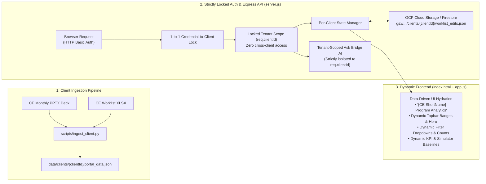

# Multi-Client (Multi-CE) Architecture & Implementation Plan (v3)

> [!IMPORTANT]
> **Confirmed Architectural Decisions (v3):**
> 1. **Zero-Impact Side-by-Side Isolation**: The existing HTTP Basic Auth MVP site (`damien-program-portal`, tag `MVP`, `https://damien-program-portal-525536279111.us-central1.run.app`) remains **100% frozen and untouched**. The new Multi-Client platform will be built in a separate workspace (`bridge-program-portal`), pushed to a separate GitHub repo/branch, and deployed to a **brand-new GCP Cloud Run service (`bridge-program-portal`)** with its own independent URL.
> 2. **Strictly Locked Per-Client Access**: Each ID/password login is strictly locked 1-to-1 to a single Covered Entity (`clientId`). No cross-client switcher UI or multi-tenant enumeration is exposed in the portal.
> 3. **Durable Cloud Persistence for Worklist Edits**: Pharmacist updates (`Status`, `Date contacted`, `Notes`, `Corrected patient ID`) are persisted per client in **Google Cloud Storage (GCS) / Firestore** so all operational edits survive Cloud Run container restarts, scaling events, and future code/data redeployments.

---

## 0. Side-by-Side Deployment & Zero-Impact Isolation Strategy

To guarantee **zero impact** on the live HTTP Basic Auth MVP site (`damien-program-portal`), the new Multi-Client platform is isolated across **four layers**:

| Layer | Existing MVP Site (Frozen / Untouched) | New Multi-Client Site (Isolated) |
| :--- | :--- | :--- |
| **Local Workspace** | `C:\Users\rishi\.gemini\antigravity\scratch\damien-program-portal` | `C:\Users\rishi\.gemini\antigravity\scratch\bridge-program-portal` *(cloned from `MVP`)* |
| **GitHub Repo / Tag** | `rishibridge/damien-program-portal` (`main` / tag `MVP`) | Separate repo `rishibridge/bridge-program-portal` *(or isolated `multi-client` branch)* |
| **Cloud Run Service** | `damien-program-portal`<br>`https://damien-program-portal-525536279111.us-central1.run.app` | **`bridge-program-portal`** *(new Cloud Run service & independent URL, e.g. `https://bridge-program-portal-525536279111.us-central1.run.app`)* |
| **Worklist State Storage** | Local container state inside `damien-program-portal` | Dedicated GCS bucket path `gs://dev-dispatch-331019-portal-state/clients/<clientId>/worklist_edits.json` |
| **Local Test Port** | `3000` / `3099` | `3100` |

### Side-by-Side Rollout Sequence
1. **Freeze `damien-program-portal`**: Never run `gcloud run deploy damien-program-portal` or mutate the `MVP` tag during Multi-Client development.
2. **Clone Baseline into `bridge-program-portal`**: Copy the `MVP` codebase into `C:\Users\rishi\.gemini\antigravity\scratch\bridge-program-portal` and initialize its remote (`rishibridge/bridge-program-portal`).
3. **Develop & Test Locally on Port `3100`**: Implement Phases 1–5 below inside `bridge-program-portal` and run the Playwright E2E suite against `http://localhost:3100`.
4. **Deploy to New Cloud Run Service (`bridge-program-portal`)**:
   ```powershell
   gcloud run deploy bridge-program-portal --source "C:\Users\rishi\.gemini\antigravity\scratch\bridge-program-portal" --project dev-dispatch-331019 --region us-central1 --allow-unauthenticated
   ```
5. **Dual-Site Production Verification**: Run Playwright E2E checks against **both** the new `bridge-program-portal` URL and the original `damien-program-portal` URL to verify both sites pass 100% independently.

---

## 1. Architecture Overview



---

## 2. Audit of Single-Client Assumptions to Replace

| Layer / File | Currently Hardcoded to Damien Center | Multi-Client Change Needed |
| :--- | :--- | :--- |
| **Data Storage**<br>[data/portal_data.json](file:///C:/Users/rishi/.gemini/antigravity/scratch/damien-program-portal/data/portal_data.json) | Single `data/portal_data.json` and ephemeral local `data/runtime_state.json`. | Move baseline to `data/clients/<clientId>/portal_data.json` + `data/clients/registry.json`, and persist worklist edits to GCS / Firestore (`clients/<clientId>/worklist_edits.json`) with local disk fallback for offline dev. |
| **Strict 1-to-1 Auth Lock**<br>[server.js](file:///C:/Users/rishi/.gemini/antigravity/scratch/damien-program-portal/server.js#L36-L77) | Single Basic Auth realm; credentials unlock the single global `portalState`. | Map each login (`user:password:clientId`) strictly to one `clientId` on `req.clientId`. Remove any possibility of cross-tenant query parameters or client switching. |
| **HTML Shell & Branding**<br>[public/index.html](file:///C:/Users/rishi/.gemini/antigravity/scratch/damien-program-portal/public/index.html) | Hardcoded `<title>`, sidebar title (`Damien Program Analytics`), topbar badges (`Damien Center`, `Hello Alpha`, `Damien Pharmacy`), hero text, and static KPI cards in `#view-financials`, `#view-sources`, `#view-funnel`, `#view-medmix`, `#wlSubtab-ended`. | Hydrate all titles, badges, hero text, and KPI cards dynamically from `PORTAL_DATA.meta` and `PORTAL_DATA.slide*` inside [public/app.js](file:///C:/Users/rishi/.gemini/antigravity/scratch/damien-program-portal/public/app.js). |
| **Worklist Filter Dropdowns**<br>[public/index.html](file:///C:/Users/rishi/.gemini/antigravity/scratch/damien-program-portal/public/index.html#L557-L760) | Filter `<select>` options (`EPIC (45)`, `Paid Media (34)`, `LHD (12)`, etc.) are hardcoded in HTML. | Generate all `<select>` filter options and counts dynamically in [public/app.js](file:///C:/Users/rishi/.gemini/antigravity/scratch/damien-program-portal/public/app.js) from the authenticated client's worklist rows (`countByField`). |
| **Financial Simulator**<br>[public/app.js](file:///C:/Users/rishi/.gemini/antigravity/scratch/damien-program-portal/public/app.js#L234-L260) | Uses hardcoded `961691` YTD proceeds, `911` Sep margin/fill, `40` cost/fill, and slider maxes `101` / `37`. | Read baseline YTD proceeds, latest-month margin/fill, cost/fill, and slider `max` attributes dynamically from `PORTAL_DATA.slide3_financials` and `PORTAL_DATA.worklistSummary`. |
| **Ask Bridge AI**<br>[server.js](file:///C:/Users/rishi/.gemini/antigravity/scratch/damien-program-portal/server.js#L275-L1065) | Deterministic Q&A (`answerQuestion`) and `askGeminiWithFullData` system prompt have hardcoded Damien numbers and employer names (`evansville`, `warrick`, `staiger`, etc.). | Build the Gemini system prompt and deterministic fallback dynamically from `getClientState(req.clientId)` so every AI answer is 100% grounded in—and strictly isolated to—the authenticated client's dataset. |

---

## 3. Phased Implementation Plan

### Phase 1: Multi-Tenant Data Directory & Ingestion Pipeline (`data/clients/`)
1. **Client Registry (`data/clients/registry.json`)**:
   - Define metadata for each onboarded Covered Entity:
     - `clientId` (e.g., `"damien"`), `shortName` (`"Damien"`), `fullName` (`"Damien Center"`), `programTitle` (`"Damien Center GLP-1 Weight Loss Program"`), `pharmacyName` (`"Damien Pharmacy"`), `telehealthPartner` (`"Hello Alpha"`), `asOfDate` (`"2026-09-30"`), `asOfLabel` (`"As of September 30, 2026"`).
2. **Per-Client Baseline Files**:
   - Store each client's baseline JSON at `data/clients/<clientId>/portal_data.json` (moving Damien's verified JSON to `data/clients/damien/portal_data.json`).
3. **Standardized Ingestion CLI (`scripts/ingest_client.py`)**:
   - Generalize [scripts/build_portal_data.py](file:///C:/Users/rishi/.gemini/antigravity/scratch/damien-program-portal/scripts/build_portal_data.py) into `python scripts/ingest_client.py --client <clientId> --pptx <path> --xlsx <path>` so onboarding a new Covered Entity or refreshing a monthly report takes a single command, automatically running:
     - Slide 1–10 table, chart series, and KPI extraction
     - 4-sheet Excel worklist extraction (`Pharmacy To-Do`, `Refill Follow-Up`, `Pharmacy Data Fixes`, `Ended – Never Filled`)
     - Edit-distance (`dist ≤ 2`) fuzzy ID matching between `Pharmacy Data Fixes` and `Pharmacy To-Do`
     - Automated source-vs-portal validation checklist

---

### Phase 2: Strictly Locked Per-Client Authentication (`server.js`)
1. **1-to-1 Credential Mapping (`PORTAL_USERS`)**:
   - Configure `PORTAL_USERS` as comma-separated `username:password:clientId` entries (e.g., `damien:bridge2026:damien,client2:pass2:client2`), while keeping backward compatibility with `PORTAL_USER` / `PORTAL_PASSWORD` (defaulting to `clientId = "damien"`).
2. **Strict Tenant Locking**:
   - On every authenticated request, the Basic Auth middleware in [server.js](file:///C:/Users/rishi/.gemini/antigravity/scratch/damien-program-portal/server.js#L56-L77) verifies the credentials using `crypto.timingSafeEqual` and binds `req.clientId` directly from the authenticated credential record.
   - Ignore any client ID passed in URL query strings, headers, or request bodies so a logged-in client is **strictly locked** to their own `req.clientId` and can never access or discover another client's data.
3. **Tenant-Scoped Routes**:
   - All API routes (`/api/portal-data`, `/api/worklist/:sheet/:id`, `/api/worklist/apply-fuzzy-fixes`, `/api/worklist/reset`, `/api/worklist/export/:sheet`, and `/api/ask`) read and mutate only `req.clientId`'s state.

---

### Phase 3: Durable Google Cloud Storage (GCS) Persistence for Worklist Edits
1. **Overlay Delta Architecture (Preserves Edits Across Monthly Data Refreshes & Redeployments)**:
   - Instead of overwriting the entire `portal_data.json` blob when a pharmacist edits a row, store a compact **per-client edits overlay** keyed by stable patient/fill record identifiers (`alphaMemberId` / `pharmacyPatientId` for `todo` & `refill`, and `dateFilled|dispensedItem|prescriber|patientIdOnFile` for `fixes`):
     ```json
     {
       "clientId": "damien",
       "updatedAt": "2026-10-26T08:30:00Z",
       "edits": {
         "todo:6d3f1831": { "Status": "Contacted patient", "Date contacted": "2026-10-26", "Notes": "Left VM" },
         "fixes-unmatched:22d97e56|2026-09-30": { "Corrected patient ID": "22d97e66" }
       }
     }
     ```
   - **Why an overlay is superior**:
     1. Survives all Cloud Run container restarts and code redeployments.
     2. Even when next month's `.pptx` and `.xlsx` are ingested for that client, any in-progress pharmacist notes, contact dates, and corrected IDs for patients still on the worklist automatically carry forward!
2. **Storage Backend (`GCS + Local Fallback`)**:
   - In GCP Cloud Run, read/write `gs://<PROJECT_BUCKET>/portal-state/<clientId>/worklist_edits.json` via the Cloud Run service account (using lightweight REST calls with metadata-server OAuth token or `@google-cloud/storage`, requiring zero external keys).
   - In local development (when `GCS_STATE_BUCKET` is not set), fall back seamlessly to `data/clients/<clientId>/worklist_edits.json`.

---

### Phase 4: Dynamic, Zero-Hardcoding Frontend Hydration (`public/index.html` & `public/app.js`)
1. **Dynamic Header, Badges & Titles**:
   - Document `<title>`: `${meta.programTitle} — ${meta.preparedBy}`
   - Left sidebar header (`.logo-name`): `${meta.shortName} Program Analytics` (e.g., `Damien Program Analytics`)
   - Topbar subtitle (`.topbar-sub`): `As of ${meta.asOfDateFormatted}`
   - Topbar badges (`.badges`): `${meta.client}`, `${meta.telehealthPartner}`, `${meta.pharmacyPartner}`
2. **Dynamic Section Headlines, KPIs & Simulator Bounds**:
   - Hydrate all view headlines, hero banner metrics, Financials 4 KPI cards, Simulator sliders (`max` set dynamically to `worklistSummary.todoTotal` and `worklistSummary.refillTotal`, default margin/fill set to `slide3_financials.septemberGrossMarginPerFill`), Funnel subtitles, Refill subtitles, and Ended stage KPI cards from `PORTAL_DATA`.
3. **Dynamic Worklist Filter Dropdowns**:
   - Populate `#todoPriorityFilter`, `#todoFindingFilter`, `#todoSourceFilter`, `#todoFuzzyFilter`, `#refillStatusFilter`, `#refillSourceFilter`, `#endedStageFilter`, `#endedFindingFilter`, and `#endedSourceFilter` dynamically from the active client's rows and counts when `PORTAL_DATA` loads.

---

### Phase 5: Dynamic, Tenant-Isolated Ask Bridge AI (`server.js`)
1. **Dynamic Gemini System Prompt**:
   - Build the `systemInstruction` in `askGeminiWithFullData(clientId, question, history)` dynamically from `state.meta` and `state.slide*` so it automatically speaks as a teammate supporting `${state.meta.client}` and `${state.meta.pharmacyPartner}`, citing only that client's exact revenue, net proceeds, funnel, and worklist records.
2. **Dynamic Deterministic Q&A Fallback**:
   - Refactor `answerQuestion(clientId, question)` to read all numbers, employer groups, prescribers, and cohort tables dynamically from `state` with zero hardcoded Damien strings.
