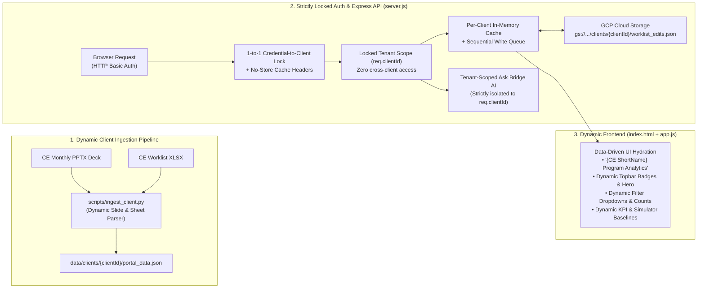

# Multi-Client (Multi-CE) Architecture & Implementation Plan (v4 — Execution-Ready)

> [!IMPORTANT]
> **Confirmed Architectural Decisions (v4):**
> 1. **Zero-Impact Side-by-Side Isolation**: The existing HTTP Basic Auth MVP site (`damien-program-portal`, tag `MVP`, `https://damien-program-portal-525536279111.us-central1.run.app`) remains **100% frozen and untouched**. The new Multi-Client platform will be built in a separate workspace (`bridge-program-portal`), pushed to a separate GitHub repo/branch, and deployed to a **brand-new GCP Cloud Run service (`bridge-program-portal`)** with its own independent URL.
> 2. **Strictly Locked Per-Client Access**: Each ID/password login is strictly locked 1-to-1 to a single Covered Entity (`clientId`). No cross-client switcher UI or multi-tenant enumeration is exposed in the portal, and strict HTTP cache headers prevent cross-session browser caching.
> 3. **Durable Cloud Persistence for Worklist Edits**: Pharmacist updates (`Status`, `Date contacted`, `Notes`, `Corrected patient ID`) are persisted per client in **Google Cloud Storage (GCS)** via a collision-free overlay delta with an in-memory cache and sequential write-through queue, so all operational edits survive Cloud Run container restarts, scaling events, and future monthly data refreshes.

---

## 0. Side-by-Side Deployment & Zero-Impact Isolation Strategy

To guarantee **zero impact** on the live HTTP Basic Auth MVP site (`damien-program-portal`), the new Multi-Client platform is isolated across **five layers**:

| Layer | Existing MVP Site (Frozen / Untouched) | New Multi-Client Site (Isolated) |
| :--- | :--- | :--- |
| **Local Workspace** | `C:\Users\rishi\.gemini\antigravity\scratch\damien-program-portal` | `C:\Users\rishi\.gemini\antigravity\scratch\bridge-program-portal` *(cloned from `MVP`)* |
| **GitHub Repo / Tag** | `rishibridge/damien-program-portal` (`main` / tag `MVP`) | Separate repo `rishibridge/bridge-program-portal` *(or isolated `multi-client` branch)* |
| **Cloud Run Service** | `damien-program-portal`<br>`https://damien-program-portal-525536279111.us-central1.run.app` | **`bridge-program-portal`** *(new Cloud Run service & independent URL, e.g. `https://bridge-program-portal-525536279111.us-central1.run.app`)* |
| **Worklist State Storage** | Local container state inside `damien-program-portal` | Dedicated GCS bucket path `gs://dev-dispatch-331019-portal-state/clients/<clientId>/worklist_edits.json` |
| **Local Test Port** | `3000` / `3099` | `3100` |

### Side-by-Side Rollout Sequence
1. **Freeze `damien-program-portal`**: Never run `gcloud run deploy damien-program-portal` or mutate the `MVP` tag during Multi-Client development.
2. **Clone Baseline into `bridge-program-portal`**: Copy the `MVP` codebase into `C:\Users\rishi\.gemini\antigravity\scratch\bridge-program-portal` and initialize its remote (`rishibridge/bridge-program-portal`).
3. **Develop & Test Locally on Port `3100`**: Implement Phases 1–6 below inside `bridge-program-portal` and run the Playwright E2E suite against `http://localhost:3100`.
4. **Deploy to New Cloud Run Service (`bridge-program-portal`)**:
   ```powershell
   gcloud run deploy bridge-program-portal --source "C:\Users\rishi\.gemini\antigravity\scratch\bridge-program-portal" --project dev-dispatch-331019 --region us-central1 --allow-unauthenticated
   ```
5. **Dual-Site Production Verification**: Run Playwright E2E checks against **both** the new `bridge-program-portal` URL and the original `damien-program-portal` URL to verify both sites pass 100% independently.

---

## 1. Architecture Overview



---

## 2. Complete Audit of Single-Client Assumptions & Engineering Refinements (v4)

| # | Layer / File | Currently Hardcoded to Damien Center | Multi-Client Change Needed (v4 Specification) |
| :- | :--- | :--- | :--- |
| **1** | **Ingestion Script**<br>`scripts/build_portal_data.py` | Hardcodes `Pharmacy Data Fixes` row numbers (`range(6, 61)` for No-ID and `range(65, max_row+1)` for Unmatched-ID) and hardcodes Slides 1–10 as Python dicts. | Build `scripts/ingest_client.py` to **dynamically scan** Excel sheets for section banners (`"Fills with no Patient Alternate ID"`, `"Patient IDs that don't match"`, `"Total"`) and dynamically parse `.pptx` tables, chart series, and KPI shapes via `python-pptx` + `openpyxl`. |
| **2** | **Data Storage & Overlay Keys**<br>`data/portal_data.json` | Single `data/portal_data.json` and ephemeral local `data/runtime_state.json`. | Move baseline to `data/clients/<clientId>/portal_data.json` + `data/clients/registry.json`. Key the GCS worklist edits overlay with a **collision-free composite key** (`alphaMemberId` for `todo`/`refill`, and `dateFilled\|dispensedItem\|prescriber\|payer\|occurrenceIndex` for `fixes-noid`) so duplicate same-day fills never collide. |
| **3** | **GCS Concurrency & Latency**<br>`server.js` | Synchronous `fs.writeFileSync` to a single local file. | Maintain an **in-memory state cache per `clientId`** paired with a **per-client sequential async write-through queue** to GCS (`gs://<BUCKET>/clients/<clientId>/worklist_edits.json`, with local disk fallback). Guarantees `<10ms` API response time and zero race conditions when multiple pharmacists edit rows concurrently. |
| **4** | **Strict 1-to-1 Auth & HTTP Cache Isolation**<br>`server.js` | Single Basic Auth realm (`damien` / `bridge2026`); static asset caching could retain HTML/JSON across credential changes. | Map each login (`username:password:clientId`) strictly 1-to-1 to `req.clientId` via `crypto.timingSafeEqual`. Emit `Cache-Control: private, no-store, no-cache, must-revalidate` and `Vary: Authorization` on `/` and `/api/*` so browsers/proxies never leak cached responses across credentials. |
| **5** | **CSV Export Filenames**<br>`server.js` | Hardcodes `Damien_Pharmacy_To_Do_Sep2026.csv`, `Damien_Refill_Follow_Up_Sep2026.csv`, etc. | Generate CSV download filenames dynamically from tenant metadata: `${meta.shortName}_${sheetSlug}_${meta.asOfShort}.csv`. |
| **6** | **HTML Shell & Branding**<br>`public/index.html` | Hardcoded `<title>`, sidebar title (`Damien Program Analytics`), topbar badges (`Damien Center`, `Hello Alpha`, `Damien Pharmacy`), hero text, and static KPI cards. | Hydrate all titles, badges, hero text, and KPI cards dynamically from `PORTAL_DATA.meta` and `PORTAL_DATA.slide*` inside `public/app.js`. |
| **7** | **Worklist Filter Dropdowns & Cutoff Badge**<br>`public/index.html`, `public/app.js` | Hardcoded `<select>` options (`EPIC (45)`, etc.) and hardcoded `'2026-09-30'` date cutoff in `Pharmacy Data Fixes`. | Generate all `<select>` filter options and counts dynamically from the client's worklist rows, and compare `r['Date filled'] > PORTAL_DATA.meta.asOfDate` dynamically for post-cutoff badging. |
| **8** | **Financial Simulator**<br>`public/app.js` | Uses hardcoded `961691` YTD proceeds, `911` Sep margin/fill, `40` cost/fill, and slider maxes `101` / `37`. | Read baseline YTD proceeds, latest-month margin/fill, cost/fill, and slider `max` attributes dynamically from `PORTAL_DATA.slide3_financials` and `PORTAL_DATA.worklistSummary`. |
| **9** | **Ask Bridge AI**<br>`server.js` | Deterministic Q&A (`answerQuestion`) and `askGeminiWithFullData` system prompt have hardcoded Damien numbers and employer names (`evansville`, `warrick`, `staiger`, etc.). | Build the Gemini system prompt and deterministic fallback dynamically from `getClientState(req.clientId)` so every AI answer is 100% grounded in—and strictly isolated to—the authenticated client's dataset. |

---

## 3. Phased Implementation Plan

### Phase 1: Multi-Tenant Data Directory & Dynamic Ingestion Pipeline (`data/clients/` & `scripts/ingest_client.py`)
1. **Client Registry (`data/clients/registry.json`)**:
   - Define metadata for each onboarded Covered Entity:
     - `clientId` (`"damien"`), `shortName` (`"Damien"`), `fullName` (`"Damien Center"`), `programTitle` (`"Damien Center GLP-1 Weight Loss Program"`), `pharmacyName` (`"Damien Pharmacy"`), `telehealthPartner` (`"Hello Alpha"`), `asOfDate` (`"2026-09-30"`), `asOfShort` (`"Sep2026"`), `asOfLabel` (`"As of September 30, 2026"`).
2. **Per-Client Baseline Files**:
   - Store each client's baseline JSON at `data/clients/<clientId>/portal_data.json` (moving Damien's verified JSON to `data/clients/damien/portal_data.json`).
   - Also generate a second synthetic test tenant (`data/clients/demo-ce/portal_data.json`, e.g., `"Metro Health CE"`) so automated multi-tenant E2E tests can verify 100% tenant isolation immediately.
3. **Dynamic Ingestion CLI (`scripts/ingest_client.py`)**:
   - Upgrade `scripts/build_portal_data.py` into `python scripts/ingest_client.py --client <clientId> --pptx <path> --xlsx <path>`:
     - **Dynamic Excel Section Scanner**: Instead of assuming rows `6..60` and `65..95`, scan `Pharmacy Data Fixes` rows dynamically for the `"Fills with no Patient Alternate ID"` header, the `"Total"` summary row, and the `"Patient IDs that don't match"` header so any CE worklist size parses cleanly.
     - **Collision-Free `stableKey` Generation**: Assign a deterministic `stableKey` to every worklist row at ingestion time (`todo:{alphaMemberId}`, `refill:{alphaMemberId}`, `fixes-noid:{dateFilled}|{dispensedItem}|{prescriber}|{payer}|#{occIdx}`, `fixes-unmatched:{patientIdOnFile}|{dateFilled}|{dispensedItem}|#{occIdx}`).
     - **Dynamic Slide & Table Extraction**: Parse `.pptx` tables, chart series, and KPI shapes via `python-pptx` and cross-validate against the Excel sheets automatically.

---

### Phase 2: Strictly Locked Per-Client Authentication & Anti-Cache Isolation (`server.js`)
1. **1-to-1 Credential Mapping (`PORTAL_USERS`)**:
   - Configure `PORTAL_USERS` as comma-separated `username:password:clientId` entries (e.g., `damien:bridge2026:damien,metro:metro2026:demo-ce`), while keeping backward compatibility with `PORTAL_USER` / `PORTAL_PASSWORD` (defaulting to `clientId = "damien"`).
2. **Strict Tenant Locking (`req.clientId`)**:
   - On every authenticated request, the Basic Auth middleware in `server.js` verifies the credentials using `crypto.timingSafeEqual` and binds `req.clientId` directly from the authenticated credential record.
   - Ignore any client ID passed in URL query strings, headers, or request bodies so a logged-in client is **strictly locked** to their own `req.clientId`.
3. **Anti-Caching Headers**:
   - Set `Cache-Control: private, no-store, no-cache, must-revalidate` and `Vary: Authorization` on HTML and API responses so switching credentials or logging out never serves stale tenant data from browser cache.
4. **Tenant-Scoped Routes & Dynamic CSV Filenames**:
   - All API routes (`/api/portal-data`, `/api/worklist/:sheet/:id`, `/api/worklist/apply-fuzzy-fixes`, `/api/worklist/reset`, `/api/worklist/export/:sheet`, and `/api/ask`) read and mutate only `req.clientId`'s state, and `/api/worklist/export/:sheet` names downloads `${meta.shortName}_${sheetSlug}_${meta.asOfShort}.csv`.

---

### Phase 3: Durable Google Cloud Storage (GCS) Persistence for Worklist Edits
1. **Collision-Free Overlay Delta Architecture**:
   - Store a compact per-client edits overlay keyed by each row's deterministic `stableKey`:
     ```json
     {
       "clientId": "damien",
       "updatedAt": "2026-10-26T08:30:00Z",
       "edits": {
         "todo:6d3f1831": { "Status": "Contacted patient", "Date contacted": "2026-10-26", "Notes": "Left VM" },
         "fixes-unmatched:22d97e56|2026-09-30|zepbound 5mg|#1": { "Corrected patient ID": "22d97e66" }
       }
     }
     ```
   - **Why this overlay design is rock-solid**:
     1. Survives all Cloud Run container restarts, scaling events, and code redeployments.
     2. Carries forward pharmacist notes, contact dates, and corrected IDs across future monthly `.pptx`/`.xlsx` refreshes for any patient still on the worklist.
     3. Handles duplicate same-day No-ID fills cleanly via `#occIdx` without key collisions.
2. **In-Memory Cache + Sequential Write-Through Queue to GCS**:
   - On server startup (or first request for `clientId`), load `data/clients/<clientId>/portal_data.json` + the overlay from `gs://<GCS_STATE_BUCKET>/clients/<clientId>/worklist_edits.json` into memory.
   - On `PATCH /api/worklist/:sheet/:id`, `POST /api/worklist/apply-fuzzy-fixes`, or `POST /api/worklist/reset`, update the in-memory tenant state immediately (`<10ms`) and enqueue a sequential write to GCS (using Cloud Run's built-in service account metadata token or `@google-cloud/storage`, with automatic local disk fallback to `data/clients/<clientId>/worklist_edits.json` during local development).

---

### Phase 4: Dynamic, Zero-Hardcoding Frontend Hydration (`public/index.html` & `public/app.js`)
1. **Dynamic Header, Badges & Titles**:
   - Document `<title>`: `${meta.programTitle} — ${meta.preparedBy}`
   - Left sidebar header (`.logo-name`): `${meta.shortName} Program Analytics`
   - Topbar subtitle (`.topbar-sub`): `As of ${meta.asOfDateFormatted}`
   - Topbar badges (`.badges`): `${meta.client}`, `${meta.telehealthPartner}`, `${meta.pharmacyPartner}`
2. **Dynamic Section Headlines, KPIs, Simulator Bounds & Date Cutoffs**:
   - Hydrate all view headlines, hero banner metrics, Financials 4 KPI cards, Simulator sliders (`max` set dynamically to `worklistSummary.todoTotal` and `worklistSummary.refillTotal`, default margin/fill set to `slide3_financials.septemberGrossMarginPerFill`), Funnel subtitles, Refill subtitles, Ended stage KPI cards, and `Pharmacy Data Fixes` post-cutoff badges (`Date filled > meta.asOfDate`) from `PORTAL_DATA`.
3. **Dynamic Worklist Filter Dropdowns**:
   - Populate `#todoPriorityFilter`, `#todoFindingFilter`, `#todoSourceFilter`, `#todoFuzzyFilter`, `#refillStatusFilter`, `#refillSourceFilter`, `#endedStageFilter`, `#endedFindingFilter`, and `#endedSourceFilter` dynamically from the active client's rows and counts when `PORTAL_DATA` loads.

---

### Phase 5: Dynamic, Tenant-Isolated Ask Bridge AI (`server.js`)
1. **Dynamic Gemini System Prompt**:
   - Build the `systemInstruction` in `askGeminiWithFullData(clientId, question, history)` dynamically from `state.meta` and `state.slide*` so it speaks as a teammate supporting `${state.meta.client}` and `${state.meta.pharmacyPartner}`, citing only that client's exact revenue, net proceeds, funnel, and worklist records.
2. **Dynamic Deterministic Q&A Fallback**:
   - Refactor `answerQuestion(clientId, question)` to read all numbers, employer groups, prescribers, and cohort tables dynamically from `state` with zero hardcoded Damien strings.

---

### Phase 6: Two-Tenant Automated Verification Matrix (Local & GCP Production)
1. **Source-Fidelity Regression Suite (`damien` login)**:
   - Run all 25 existing Playwright E2E checks using `damien:bridge2026` to prove 100% of Damien Center's numbers, tables, charts, worklist filters, simulator calculations, and Ask Bridge AI responses remain identical to `MVP`.
2. **Cross-Tenant Isolation & Dynamic Hydration Suite (`demo-ce` login)**:
   - Log in with the second test client (`metro:metro2026`) and verify via Playwright:
     - Sidebar, topbar badges, `<title>`, hero metrics, KPI cards, filter dropdown counts, simulator bounds, CSV filenames, and Ask Bridge AI responses all reflect `Metro Health CE` with zero `"Damien"` strings anywhere in the DOM or API payload.
     - Editing a worklist row or applying fuzzy fixes as `metro` persists to `clients/demo-ce/worklist_edits.json` in GCS and has **zero effect** on `damien`'s worklist state.
3. **Live MVP Non-Impact Verification**:
   - Re-run the Playwright E2E suite against the original `https://damien-program-portal-525536279111.us-central1.run.app` service to confirm it remains untouched at revision `damien-program-portal-00009-dm9`.
